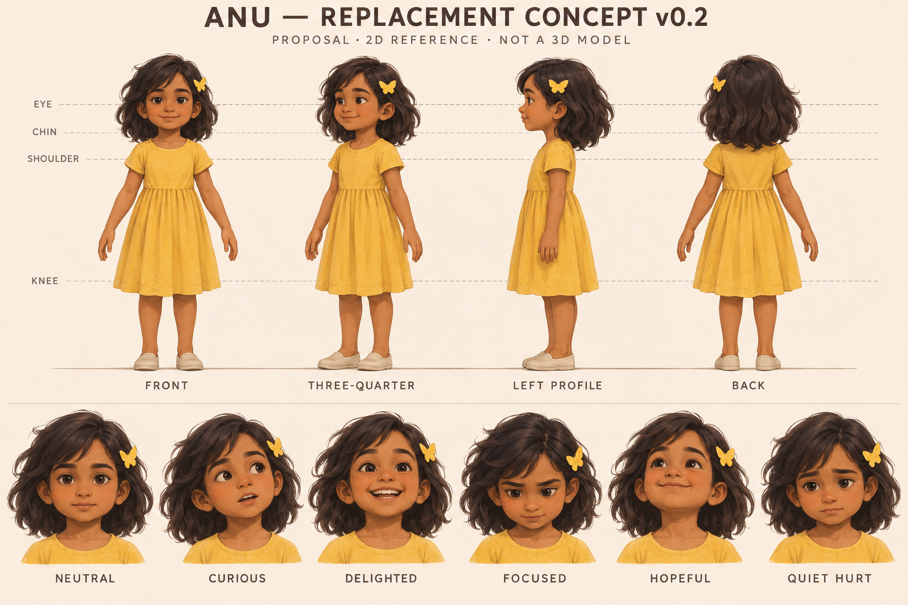

# Anu replacement candidate — v0.2
Date: 2026-11-11. Status: GENERATED AND ARCHIVED; OWNER VISUAL REVIEW PENDING.
This is a new proposed 2D design, not the missing original, not an exact-match reconstruction, not an approved modeling blueprint and not a Blender model.

## Why a replacement exists
The owner said they have no images and authorized designing Anu or finding artwork in another chat. The available chat-history listing was searched; the relevant earlier character/story discussions were read. Retrieved material provided written descriptions and the two original filenames, but no accessible Anu image attachments. Recovery is not claimed.
The original source registry remains unchanged and pending. This candidate has a separate filename, hash and status.

## Actual source image

- [Full PNG](../assets/characters/anu/reference/candidates/v002/anu_replacement_concept_v02.png): 1536×1024, 2,193,318 bytes.
- SHA-256: `1b19b51c7d24d44c66ea0d27404e1886ea1683b5730b7b8deb1f92154efff890`.
- Git blob: `218ccf3b0f427cf55b015ca75d1ac9ddf75d0bd1`.
- [Generation prompt](../assets/characters/anu/reference/candidates/v002/generation_prompt.txt).
- [Candidate registry](../assets/characters/anu/reference/candidates/v002/reference_manifest.json).

## Preserved requirements and proposed details
Preserved: five-year-old South Indian identity, messy shoulder-length dark hair, yellow butterfly clip, complete front teeth.
New drawn facial proportions, skin palette, exact hair masses and clip geometry are proposed visual interpretations. Plain yellow dress and light shoes remain wardrobe proposals; the bag is omitted from this study, not canonically rejected.
Clip at anatomical left temple is a provisional consistency convention, not recovered canon.

## Visual review and construction limits
The sheet contains front, three-quarter, left profile and back views plus neutral, curious, delighted, focused, hopeful and quiet-hurt heads. Visual inspection found a broadly coherent candidate identity; this is a human review judgment, not proof of identical geometry.
The full-body poses and guide alignments are not exact orthographic matches. Do not measure the image as an engineering drawing. The prompt requested a head/body ratio, but the output has not been accepted to that ratio; no physical height or proportion lock is inferred from prompt intent.
Head/eye spacing, ear position, nose/chin depth, hair outline and clip attachment require a corrected construction pass. Hair should be interpreted as sculptable masses rather than mandatory individually simulated strands. Dress folds are appearance suggestions, not cloth-simulation requirements.
No face rig, facial deformation, child-anatomy approval or render-cost test is supplied by this image.

## Replacement-source gate
1. Owner reviews this exact candidate PNG: face/age read, hair silhouette and clip, then wardrobe and clip side.
2. Log accepted changes and owner approval against the image hash. Only then may this become the new active visual baseline. Permission to create this candidate is not its visual approval.
3. Prepare aligned modeling references while preserving that accepted face. Compare corrected views with the source; record every resolved discrepancy.
4. Build the Anu-specific model/rig proof under 08_ANU_FEASIBILITY_TEST.md. The generic pipeline test in 11 does not substitute for this.

This is an explicit alternate route to R0 in 07: a newly approved replacement can become the baseline if the lost original cannot be recovered. It never changes the status of the missing original to recovered. R1 and all Anu-specific technical gates remain required.

## If the old files later become available
The precise original requested files were:
- anu_turnaround_exploration_v01.png — the four-view full-body study.
- anu_expressions_exploration_v01.png — facial expression studies.
Both came from the earlier character-development delivery. A readable uncropped screenshot of that exact artwork could help identify the old look if original downloads fail, but must be labeled screenshot evidence.
Do not use unrelated mood boards, the generic engineering figure, other-story characters or new AI generations as the missing original.
