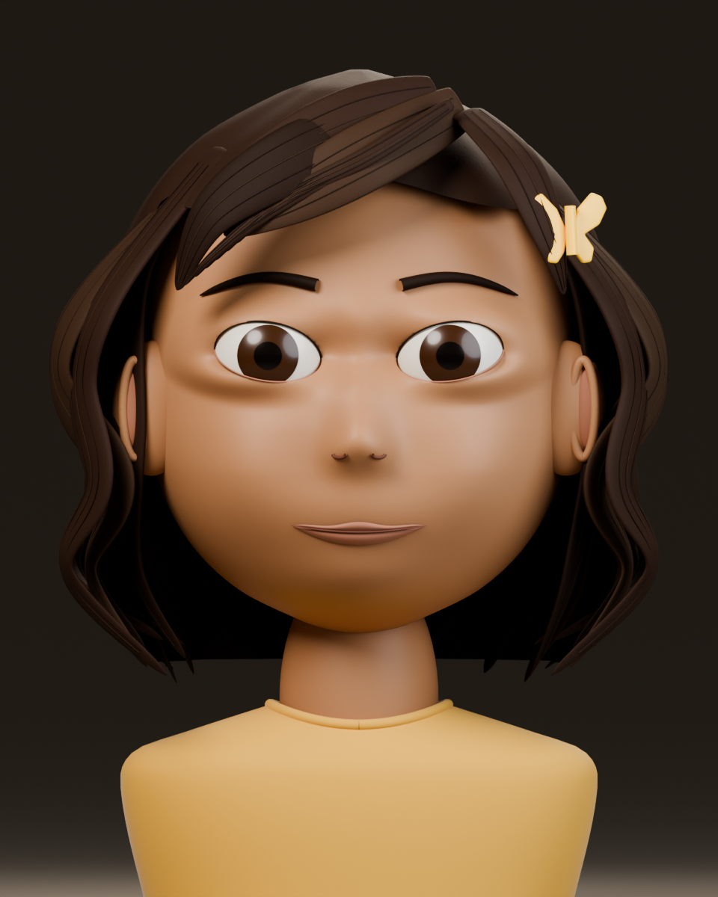
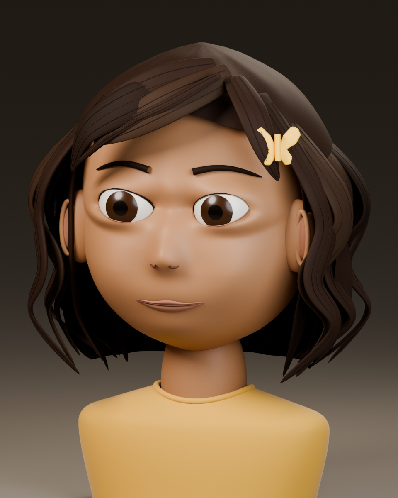

# Anu — approved reference and 3D quality handoff v0.1
Date: 2026-11-11. Asset ID: CH_ANU.
Status: APPROVED 2D BASELINE; LOCAL 3D HEAD STUDY NOT ACCEPTED FOR LIKENESS OR FINAL QUALITY.

## What is established
The owner approved the appearance of the replacement v0.2 sheet and authorized continuing into Blender. This approval covers the visible face/hair/wardrobe/clip direction. It does not establish exact physical dimensions, hidden geometry, final topology, a rig or finished render quality.
The reference baseline is CH_ANU_ref_v002, source PNG SHA-256:
`1b19b51c7d24d44c66ea0d27404e1886ea1683b5730b7b8deb1f92154efff890`.
The immutable PNG still carries its original proposal header; its current approval state is recorded in the registry.
The lost v0.1 images remain unrecovered. No story, cast, scene order, Amma framing or ending change is introduced.

## Actual completed work
- Exact rectangular source crops for front, left profile, back and three-quarter, with coordinates and decoded RGB checksums in [crop receipt](evidence/anu_source_v002/crop_receipt.json). No repainting, scaling or regeneration.
- A native Blender reference workspace with four packed guide images, orthographic cameras and a proposed lighting/render setup; save/reopen verified.
- A real, editable local head-and-shoulder study: continuous head surface, sculpt-stage Boolean-cut eye openings, eyes/lips/ears, 38 hair-mass locks, 114 strand-detail curves, separate butterfly clip and a simple bust garment.
- [Native Blender study](../blender/characters/anu/studies/v007/anu_head_likeness_study_v007.blend), with the exact approved source image packed inside. The source path and render path are relative; the study is not a production master.
- Actual front and three-quarter Cycles CPU renders, each 960×1200, 128 maximum samples, adaptive threshold 0.015 and denoising.
- Reopened the native study independently; checked finite mesh coordinates, packed reference hash and clip-side placement. [Structural evidence](evidence/anu_head_v007/structural_verification.json) explicitly marks likeness and production-quality gates NOT PASSED.

## Actual render evidence — unaccepted study



These are Blender renders of the mesh, not generated 2D illustrations or an accepted final character. Higher resolution does not establish visual fidelity.

## Visual review: defects that still prevent acceptance
1. Facial proportions and child-age read differ from the approved sheet. The eye/lid region remains too stylized and heavy; cheek, nose and chin forms need a character-sculpting pass against the reference.
2. Hair reads as coarse sculpted strips, with inadequate natural breakup and texture. The source's soft, messy silhouette and fringe flow are not yet matched.
3. One butterfly wing is obscured by hair from the review angles. Correct its attachment depth/orientation while retaining the approved side and recognizable butterfly silhouette.
4. Materials are preliminary. Skin, eyes and hair need refined surface treatment and the approved tactile finish, not merely more samples.
5. The bust is a construction study, not the approved full dress/body. No mouth interior, teeth, full hands/body, facial rig or performance is provided.

No final-look acceptance, 100-percent visual match or feature-film-quality claim is made. The current procedural construction is insufficient to declare the requested finish achieved. A skilled character-sculpting, topology and texture pass remains necessary; this draft may be reused only where it helps that work.

## Required next deliverable
Produce an artist-refined, reference-matched Anu head before extending this approximation into a full body:
- Match front/profile/three-quarter head silhouette; cheek/chin volume; eye spacing, scale and lid contours; nose profile; ears and mouth shape to the approved PNG.
- Build coherent eyelid and mouth topology with closed eyes, lid contact, lips sealing and no intersecting skin layers. The current Boolean loops and separate lip surfaces need production retopology.
- Preserve dark shoulder-length messy hair, complete front teeth and the yellow butterfly clip. Hair masses may use static curves/cards or a groom, but must preserve silhouette and remain feasible to rig/render.
- Restore the correct soft hairline, believable material response and a clean, fully readable clip in all three review views.
- Supply neutral, daylight and dim-bounce comparisons, plus curiosity, delight and quiet hurt. Keep background and exposure controlled so lighting cannot hide likeness drift.
- Deliver editable sculpt and clean topology, all texture/material dependencies and a versioned comparison sheet. Get owner acceptance against this reference version before promoting any 3D asset to master.
After that: child-proportioned full body, the approved simple yellow dress and light shoes, hands/feet, facial/body rig and the bounded feasibility exercises in 08. Do not introduce the earlier speculative bag or story props through modeling convenience.

## Gate state
| Gate | Current state |
| --- | --- |
| R0 approved reference ingest | PASSED through explicitly approved replacement; original v0.1 still missing |
| R1 exact construction packet/scale | PARTIAL; source views have pose/proportion inconsistencies; no physical-height lock |
| G1 3D likeness | NOT PASSED |
| G2 character deformation | NOT RUN; no rig |
| G3 final shading/look | NOT PASSED |
| G4 production asset reuse | NOT RUN for Anu; the earlier generic probe is separate |
| G5 representative character/shot cost | NOT PASSED; only raw study render observations |
| G6 production release | NOT ISSUED |

## Reproduce the completed local work
```text
python scripts/extract_anu_reference_views.py assets/characters/anu/reference/candidates/v002/anu_replacement_concept_v02.png work/anu_views
blender --background --factory-startup --python-exit-code 1 --python scripts/prepare_anu_workspace.py -- work/anu_views work/anu_workspace
blender --background --factory-startup --python-exit-code 1 --python scripts/build_anu_head_study.py -- work/anu_head assets/characters/anu/reference/candidates/v002/anu_replacement_concept_v02.png --build-only
blender --background --factory-startup --python-exit-code 1 --python scripts/verify_anu_head.py -- work/anu_head/anu_head_likeness_study_v007.blend work/anu_head/structural_verification.json
blender --background --factory-startup --python-exit-code 1 --python scripts/render_anu_portrait.py -- work/anu_head/anu_head_likeness_study_v007.blend work/anu_head --cpu --beauty
blender --background --factory-startup --python-exit-code 1 --python scripts/render_anu_portrait.py -- work/anu_head/anu_head_likeness_study_v007.blend work/anu_head --cpu --beauty --front
```
Extraction needs ffmpeg on PATH. The Blender commands were tested on 5.3.0 build 02f0899d78e3.
Cycles GPU execution failed on the available local device; CPU completed the study renders. CPU is the renderer script's safe default. These observations do not forecast the film's render budget.
External 3D generation was unavailable and produced no mesh. This study was constructed locally; no provider mesh is being passed off as completed work.

## Native artifact identity
Blender study SHA-256: `319be176dca11c66849fa02ddf8c9b9d68293f1a2273d50613067582c47e2aa1`.
Git blob SHA: `044cbd8bd278d131340b0ff9276a445ca10b8299`.
The structural checks confirm artifact integrity only; they never certify likeness or final quality.
